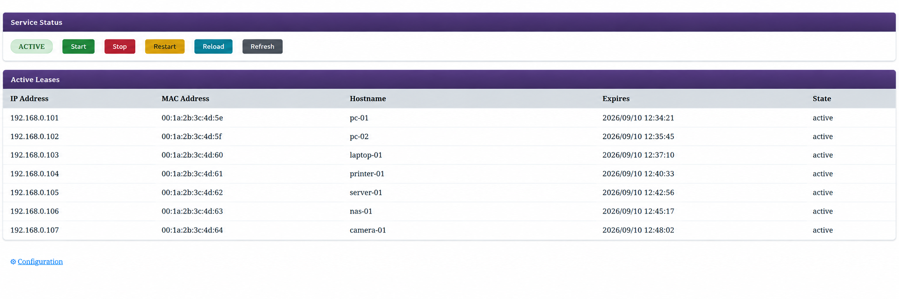

<!--
PyDHCP documentation
FILE: README.md
-->
# [PyDHCP](https://github.com/maravento)

[](https://github.com/maravento/pydhcp)
[](https://github.com/maravento/pydhcp)
[](https://github.com/maravento/pydhcp/stargazers)
[](https://twitter.com/maraventostudio)

<table width="100%">
  <tr>
    <td style="width: 50%; vertical-align: top;">
      <b>PyDHCP</b> is an open-source IPv4 DHCP server written in Python. <br>
      <br>
      <a href="https://github.com/isc-projects/dhcp">isc-dhcp-server</a> reached end of life in 2022. PyDHCP keeps several of its features and a similar configuration style, which can make migration easier. Its supported features are listed in SCOPE. <br>
      <br>
      PyDHCP implements DHCP under RFC 2131 over UDP ports 67 and 68. It uses a similar configuration syntax and lease-file format, with its own file paths. It runs as a <code>systemd</code> service. The legacy <code>/etc/init.d/pydhcpd</code> script is a compatibility interface for the <code>service</code> command; when systemd is active, it delegates actions to <code>systemctl</code> rather than starting a separate daemon.
    </td>
    <td style="width: 50%; vertical-align: top;">
      <b>PyDHCP</b> es un servidor DHCP IPv4 de código abierto escrito en Python. <br>
      <br>
      <a href="https://github.com/isc-projects/dhcp">isc-dhcp-server</a> llegó al fin de su ciclo de vida en 2022. PyDHCP conserva varias de sus funciones y una sintaxis de configuración similar, lo que puede facilitar la migración. Sus funciones se detallan en SCOPE. <br>
      <br>
      PyDHCP implementa DHCP según la RFC 2131 sobre los puertos UDP 67 y 68. Usa una sintaxis de configuración y un formato de archivo de concesiones similares, con rutas propias. Funciona como servicio de <code>systemd</code>. El script heredado <code>/etc/init.d/pydhcpd</code> ofrece compatibilidad con el comando <code>service</code>; cuando systemd está activo, delega las acciones en <code>systemctl</code> en lugar de iniciar otro demonio.
    </td>
  </tr>
</table>

<!-- markdownlint-disable MD033 -->

## REQUIREMENTS

---

### Compatibility

<table width="100%">
  <tr>
    <td style="width: 50%; vertical-align: top;">
      <p>Only tested on Ubuntu 24.04/26.04 LTS. Other versions or distributions are not tested and are used at your own risk.</p>
    </td>
    <td style="width: 50%; vertical-align: top;">
      <p>Solo probado en Ubuntu 24.04/26.04 LTS. Otras versiones o distribuciones no están probadas y se usan bajo tu responsabilidad.</p>
    </td>
  </tr>
</table>

### Software

| Component | Requirements | Requisitos |
|---|---|---|
| Daemon | Python 3.8+ and systemd | Python 3.8+ y systemd |
| Installer checks | `iproute2`, `passwd`, `util-linux`, `coreutils`, `grep`, `sed`, `iputils-ping`, `findutils`, `libc-bin`, `logrotate`, `curl`, `zip`, `cron` | El instalador comprueba que estos paquetes estén instalados |
| Optional WPAD | Apache and `apache2-utils`; the installer installs missing packages | Apache y `apache2-utils`. El instalador instala los paquetes ausentes |
| Optional Webmin module | Webmin, Perl and `ncurses-bin`, in addition to the shared command dependencies | Webmin, Perl y `ncurses-bin`, además de las dependencias de comandos compartidas |

## REPOSITORY STRUCTURE

---

```
pydhcp/
├── conf/
│   └── wpad.conf           # Apache VirtualHost of the WPAD/PAC server, deployed by pysetup.sh
│
├── core/
│   ├── pydhcpd.py          # DHCP daemon: handles DISCOVER/OFFER/REQUEST/ACK
│   └── pydhcpd.conf        # Daemon config: hosts, pools, lease timers
│
├── init.d/
│   └── pydhcpd             # init.d-style start/stop/status wrapper around the systemd service
│
├── service/
│   └── pydhcpd.service     # systemd unit that runs the daemon
│
├── tools/
│   ├── pydhcpenv.sh        # Shared Bash configuration reader (sourced, not executed)
│   ├── pybk.sh             # Backup pydhcp configuration and data (see Tools section)
│   ├── pyleases.sh         # Rebuilds pydhcpd.conf from ACL files and manages leases (see Tools section)
│   └── pywebmin.sh         # Installs the Webmin module for managing pydhcpd from the browser (see Tools section)
│
└── pysetup.sh          # Installs, updates or removes pydhcp
```

## HOW TO USE

---

```bash
git clone --depth=1 https://github.com/maravento/pydhcp.git
cd pydhcp

# Install
sudo bash pysetup.sh --install

# Update
sudo bash pysetup.sh --update

# Uninstall
sudo bash pysetup.sh --uninstall

# Status
sudo bash pysetup.sh --status

# Interactive menu
sudo bash pysetup.sh

# Help
sudo bash pysetup.sh --help   # or -h
```

| Action | Description | Descripción |
|---|---|---|
| `sudo bash pysetup.sh` | Opens the interactive menu | Abre el menú interactivo |
| `sudo bash pysetup.sh --install` | Installs pydhcp. Aborts if already installed | Instala pydhcp. Aborta si ya está instalado |
| `sudo bash pysetup.sh --update` | Updates the code and preserves the user configuration | Actualiza el código y conserva la configuración del usuario |
| `sudo bash pysetup.sh --uninstall` | Removes pydhcp, with two confirmations up front | Elimina pydhcp, con dos confirmaciones al inicio |
| `sudo bash pysetup.sh --status` | Shows service state, UDP 67 listeners, the configured interface and recent log lines. Resets the installer log at startup | Muestra el estado del servicio, las escuchas UDP 67, la interfaz configurada y las últimas líneas del log. Vacía el log del instalador al comenzar |
| `sudo bash pysetup.sh -h` | Shows the usage | Muestra el uso |

> `pysetup.sh` takes one action per run. Without arguments it opens the interactive menu, with the same four actions and an exit option.
>
> `pysetup.sh` ejecuta una acción por vez. Sin argumentos abre el menú interactivo, con las mismas cuatro acciones y una opción de salida.

## SCOPE

---

| SCOPE | ALCANCE |
|---|---|
| <ul><li>DHCPv4 on one configured LAN interface and subnet.</li><li>Dynamic address pools, static reservations and MAC admission rules.</li><li>Lease persistence, ICMP conflict checks and per-MAC allocation limits.</li><li>Optional PAC delivery through DHCP option 252 and Apache.</li><li>Configuration generation from ACL lists, backups and an optional Webmin module.</li></ul> | <ul><li>DHCPv4 en una interfaz LAN y una subred configuradas.</li><li>Pools dinámicos, reservas estáticas y reglas de admisión por MAC.</li><li>Persistencia de concesiones, comprobación ICMP y límites de asignación por MAC.</li><li>Entrega opcional de PAC mediante la opción DHCP 252 y Apache.</li><li>Generación de configuración desde listas ACL, respaldos y un módulo Webmin opcional.</li></ul> |
| **OUT OF SCOPE** | **FUERA DE ALCANCE** |
| <ul><li>DHCPv6, BOOTP/PXE and multi-subnet DHCP service.</li><li>LDAP, dynamic DNS updates and DHCP option 15.</li><li>Per-host or per-class DHCP option overrides, including different WPAD URLs.</li><li>Router failover and a shared allocation limit across all MACs.</li><li>LAN/WAN address configuration and firewall or proxy-policy management.</li><li>Mandatory proxy use and switch DHCP Snooping configuration.</li><li>Automatic PAC regeneration during updates, HTTPS setup and PAC syntax validation.</li></ul> | <ul><li>DHCPv6, BOOTP/PXE y servicio DHCP para varias subredes.</li><li>LDAP, actualizaciones DNS dinámicas y opción DHCP 15.</li><li>Opciones DHCP particulares por host o clase, incluidas URL WPAD diferentes.</li><li>Conmutación entre routers y límite de asignación compartido por todas las MAC.</li><li>Configuración de direcciones LAN/WAN y gestión de reglas de firewall o políticas de proxy.</li><li>Uso obligatorio del proxy y configuración de DHCP Snooping en switches.</li><li>Regeneración automática del PAC durante actualizaciones, configuración HTTPS y validación sintáctica del PAC.</li></ul> |

## ISC-DHCP-SERVER VS PYDHCP

---

> **Legend:** ✅ same behaviour · ⚠️ works, with a difference · ⛔ not implemented
>
> **Leyenda:** ✅ mismo comportamiento · ⚠️ funciona, con una diferencia · ⛔ no implementado

### Protocol and architecture

| isc-dhcp-server | pydhcp | Description | Descripción |
|---|---|---|---|
| DHCPv4 (RFC 2131) over UDP 67/68 | ✅ | Python daemon, same protocol | Demonio Python, mismo protocolo |
| DHCPv6 | ⛔ | IPv4 only | Solo IPv4 |
| Multiple interfaces | ⛔ | Single interface, set in `INTERFACESv4` | Interfaz única, definida en `INTERFACESv4` |
| BOOTP / PXE | ⛔ | Packets are padded to the BOOTP minimum for protocol compliance, but BOOTP clients are not served | PyDHCP completa los paquetes hasta el tamaño mínimo de BOOTP, pero no atiende a clientes BOOTP |
| DHCP relay agents | ⛔ | No legitimate use without multi-segment support. `giaddr`/`hops` are parsed only to close a spoofing hole | PyDHCP no ofrece servicio de relay. Lee `giaddr` y `hops` para detectar y descartar paquetes de relay falsificados |
| Clients whose `chaddr` differs from the frame source MAC | ⛔ | Dropped and logged: closes a spoofing hole | PyDHCP descarta y registra los paquetes si la MAC de `chaddr` no coincide con la MAC de origen Ethernet |
| LDAP backend | ⛔ | Host reservations live in `pydhcpd.conf`, or in the `mac-*.txt` lists that `pyleases.sh` turns into reservations | Las reservas de host viven en `pydhcpd.conf`, o en las listas `mac-*.txt` que `pyleases.sh` convierte en reservas |
| DDNS | ⛔ | The daemon never registers names in DNS; a lease grants an address, nothing else | El demonio nunca registra nombres en DNS; una concesión entrega una dirección, nada más |
| `client-updates` / `deny client-updates` | ⛔ | Depends on DDNS plus the client FQDN option, neither implemented | Depende de DDNS y de la opción FQDN del cliente, ninguna implementada |

### Directives

| isc-dhcp-server | pydhcp | Description | Descripción |
|---|---|---|---|
| `authoritative;` | ✅ | pydhcpd's default, accepted for compatibility | Es el valor por defecto de pydhcpd, se acepta por compatibilidad |
| `not authoritative;` | ✅ | The only way to disable authoritative mode | Única forma de desactivar el modo autoritativo |
| `server-identifier IP;` | ✅ | Mandatory: the daemon refuses to start without it | Obligatoria: el demonio no arranca sin ella |
| `cleanup-interval N;` | ✅ | Seconds between expired-lease sweeps | Segundos entre barridos de concesiones expiradas |
| `abandon-lease-time N;` | ✅ | Seconds an IP is held out of the pool after a DHCPDECLINE | Segundos que una IP queda fuera del pool tras un DHCPDECLINE |
| `deny duplicates;` | ✅ | Re-offers the MAC's existing pool lease on DISCOVER while the first pool admitting that MAC contains it | Al recibir DISCOVER, vuelve a ofrecer la concesión vigente del pool si pertenece al primer pool que admite esa MAC |
| `deny declines;` | ✅ | Ignores DHCPDECLINE messages | Ignora mensajes DHCPDECLINE |
| `ping-check true\|false;` | ✅ | Enabled by default in the shipped config, unlike isc | Activado por defecto en la configuración que se entrega, al revés que isc |
| `ping-timeout N;` | ✅ | Seconds to wait for the ICMP reply before sending the OFFER | Segundos de espera de la respuesta ICMP antes de enviar el OFFER |
| `subnet ... { pool { ... } }` | ✅ | Several `pool { }` blocks per subnet are accepted | Se aceptan varios bloques `pool { }` por subred |
| `host NAME { hardware ethernet MAC; fixed-address IP; }` | ✅ | `fixed-address` validated at config load and on `SIGHUP` | `fixed-address` se valida al cargar la configuración y en cada `SIGHUP` |
| `class` / `subclass` / `deny members of` | ✅ | Any class name is accepted, not just `blockdhcp` | Se acepta cualquier nombre de clase, no solo `blockdhcp` |
| `allow\|deny unknown-clients`, `known-clients` | ✅ | Pool-level admission rules | Reglas de admisión a nivel de pool |
| `min-lease-time`, `default-lease-time`, `max-lease-time` | ✅ | Validated together (`0 < min <= default <= max`), at subnet and pool level | Se validan en conjunto (`0 < min <= default <= max`), a nivel de subred y de pool |
| `option routers` | ⚠️ | Accepts a comma-separated list but uses only the first address; the rest are ignored with a notice. No failover between routers | Acepta varias direcciones separadas por comas, pero entrega solo la primera e informa que ignora las demás. No cambia automáticamente a otro router si el primero falla |
| `option broadcast-address` | ✅ | Served as option 28 | Se entrega como opción 28 |
| `option domain-name-servers` | ✅ | Comma-separated list, all served | Lista separada por comas, se entregan todas |
| `option wpad ...;` | ✅ | Option 252. The daemon serves it whenever the directive is present in `pydhcpd.conf`; `WPAD_ENABLED` in `pydhcp.env` decides whether `tools/pyleases.sh` writes it when it regenerates the config | Opción 252. El demonio la entrega siempre que la directiva esté en `pydhcpd.conf`; `WPAD_ENABLED` en `pydhcp.env` decide si `tools/pyleases.sh` la escribe al regenerar la configuración |
| `one-lease-per-client` | ⚠️ | Always enforced; one MAC can hold only one pool lease at a time | Se aplica siempre: cada MAC puede tener una sola concesión del pool a la vez |
| `option domain-name` | ⛔ | Option 15 is not parsed or sent by this implementation | Esta implementación no interpreta ni envía la opción 15 |
| `option subnet-mask` override | ⛔ | The netmask sent always matches the `subnet ... netmask ...` declaration | La máscara enviada siempre coincide con la declaración `subnet ... netmask ...` |
| Per-host / per-class option scoping | ⛔ | Options declared at `subnet` level apply to every client uniformly | Las opciones declaradas a nivel `subnet` aplican a todos los clientes por igual |

### Files and paths

| isc-dhcp-server | pydhcp | Description | Descripción |
|---|---|---|---|
| `/etc/dhcp/dhcpd.conf` | `/etc/pydhcp/core/pydhcpd.conf` | Similar syntax for the supported directives listed above | Sintaxis similar para las directivas admitidas indicadas arriba |
| `/var/lib/dhcp/dhcpd.leases` | `/etc/pydhcp/core/pydhcpd.leases` | Same format | Mismo formato |
| `/etc/default/isc-dhcp-server` | `/etc/pydhcp/pydhcp.env` | Bootstrap values, plus pydhcp's own extras | Valores iniciales de configuración, junto con otras variables propias de PyDHCP |
| `/run/dhcp-server/dhcpd.pid` | `/run/pydhcp/pydhcpd.pid` | Fixed path, not configurable | Ruta fija, no configurable |
| `/etc/systemd/system/isc-dhcp-server.service` | `/etc/systemd/system/pydhcpd.service` | The PyDHCP unit starts the daemon as `pydhcpd` with its two network capabilities | La unidad de PyDHCP inicia el demonio como `pydhcpd` con sus dos capacidades de red |
| `/etc/init.d/isc-dhcp-server` | `/etc/init.d/pydhcpd` | Compatible wrapper | Wrapper compatible |
| `/var/log/syslog` | `/var/log/pydhcp.log` | Writes directly to file, does not use syslog, so no `log-facility` directive is needed | Escribe directamente al archivo, no usa syslog, así que no hace falta la directiva `log-facility` |
| *(none)* | `pysetup.log` | Installer log, written in the directory containing `pysetup.sh` and rewritten on each run. Kept out of `/var/log/pydhcp.log` so install, update and remove runs never mix with daily operation | Log del instalador, escrito en el directorio que contiene `pysetup.sh` y reescrito en cada ejecución. Se mantiene fuera de `/var/log/pydhcp.log` para que las ejecuciones de instalación, actualización y desinstalación no se mezclen con la operación diaria |
| `/etc/logrotate.d/rsyslog` | `/etc/logrotate.d/pydhcp` | Daily, one config for the whole project | Diaria, una sola configuración para todo el proyecto |
| `journalctl -u isc-dhcp-server` | `journalctl -u pydhcpd` | Both also reach journald through systemd | Ambos llegan además a journald a través de systemd |

### Commands

| isc-dhcp-server | pydhcp | Description | Descripción |
|---|---|---|---|
| `systemctl start\|stop\|restart\|status isc-dhcp-server` | `systemctl start\|stop\|restart\|status pydhcpd` | Same verbs, same behaviour | Mismos verbos, mismo comportamiento |
| `service isc-dhcp-server start\|stop\|restart\|status` | `service pydhcpd start\|stop\|restart\|status` | Goes through the `init.d` wrapper, which delegates to `systemctl` when systemd is the active init | Pasa por el wrapper de `init.d`, que delega en `systemctl` cuando systemd es el init activo |
| `dhcpd -t -cf /etc/dhcp/dhcpd.conf` | `pydhcpd.py -t -cf /etc/pydhcp/core/pydhcpd.conf` | Config syntax test | Prueba de sintaxis de la configuración |

### Log output

| isc-dhcp-server | pydhcp | Description | Descripción |
|---|---|---|---|
| `DHCPREQUEST for 192.168.0.50 (192.168.0.2) from aa:bb:cc:dd:ee:ff via enpXsX`<br>`DHCPACK on 192.168.0.50 to aa:bb:cc:dd:ee:ff (FOO) via enpXsX` | `REQUEST from aa:bb:cc:dd:ee:ff (FOO)`<br>`ACK aa:bb:cc:dd:ee:ff → 192.168.0.50`<br>`(lease 2592000s)` | Authorized client with static IP (renewal) | Cliente autorizado con dirección IP fija (renovación) |
| `DHCPDISCOVER from bb:cc:dd:ee:ff:aa via enpXsX`<br>`DHCPOFFER on 192.168.0.230 to bb:cc:dd:ee:ff:aa (BAR) via enpXsX`<br>`DHCPREQUEST for 192.168.0.230 (192.168.0.2) from bb:cc:dd:ee:ff:aa (BAR) via enpXsX`<br>`DHCPACK on 192.168.0.230 to bb:cc:dd:ee:ff:aa (BAR) via enpXsX` | `DISCOVER from bb:cc:dd:ee:ff:aa (BAR)`<br>`OFFER bb:cc:dd:ee:ff:aa → 192.168.0.230`<br>`REQUEST from bb:cc:dd:ee:ff:aa (BAR)`<br>`ACK bb:cc:dd:ee:ff:aa → 192.168.0.230`<br>`(lease 60s)` | Unknown client entering the block pool | Cliente desconocido ingresando al pool de bloqueo |
| `DHCPDISCOVER from bb:cc:dd:ee:ff:aa via enpXsX: network 192.168.0.0/24: no free leases` | `DISCOVER from bb:cc:dd:ee:ff:aa (BAR)`<br>`No IP for bb:cc:dd:ee:ff:aa -skip` | Pool exhausted | Pool agotado |
| `DHCPDISCOVER from bb:cc:dd:ee:ff:aa via enpXsX: network 192.168.0.0/24: no free leases` | `DISCOVER from bb:cc:dd:ee:ff:aa (BAR)`<br>`Blocked bb:cc:dd:ee:ff:aa -skip` | Blocked client — `isc-dhcp-server` reports it as a full pool | Cliente bloqueado — `isc-dhcp-server` lo reporta como pool lleno |

> A pool with `deny members of "blockdhcp"` becomes invisible to that class, so `isc-dhcp-server` sees no lease available and logs the same message as a genuinely full pool. `pydhcpd` logs the real cause: `Blocked` or `No IP`.
>
> Un pool con `deny members of "blockdhcp"` se vuelve invisible para esa clase, así que `isc-dhcp-server` no ve ninguna concesión disponible y escribe el mismo mensaje que un pool genuinamente lleno. `pydhcpd` registra la causa real: `Blocked` o `No IP`.

### Authoritative behaviour

| Configuration | Description | Descripción |
|---|---|---|
| `authoritative;` | Enables authoritative behavior; also the PyDHCP default when neither directive is present | Activa el modo autoritativo. PyDHCP también lo utiliza cuando faltan ambas directivas |
| `not authoritative;` | Disables authoritative behavior | Desactiva el modo autoritativo |
| REQUEST selecting another server | PyDHCP ignores a REQUEST whose server identifier names another server, including in authoritative mode | PyDHCP ignora un REQUEST que identifica a otro servidor, incluso en modo autoritativo |
| REQUEST for an unavailable address | PyDHCP can send NAK in authoritative mode. In non-authoritative mode it stays silent | PyDHCP puede responder NAK en modo autoritativo. En modo no autoritativo guarda silencio |

<table width="100%">
  <tr>
    <td style="width: 50%; vertical-align: top;">
      When migrating, explicitly use <code>not authoritative;</code> if this server must remain non-authoritative. PyDHCP handles the requests addressed to this server.
    </td>
    <td style="width: 50%; vertical-align: top;">
      Durante la migración, añada <code>not authoritative;</code> si necesita conservar el modo no autoritativo. PyDHCP atiende las solicitudes dirigidas a este servidor.
    </td>
  </tr>
</table>

### Pool leases per client

<table width="100%">
  <tr>
    <td style="width: 50%; vertical-align: top;">
      PyDHCP keeps at most one active pool lease per MAC. When it grants a new pool address, it removes any different pool lease held by that MAC. This behavior is always enabled.
    </td>
    <td style="width: 50%; vertical-align: top;">
      PyDHCP conserva como máximo una concesión activa del pool por MAC. Al conceder otra dirección del pool, elimina la concesión anterior de esa MAC. Este comportamiento está siempre activo.
    </td>
  </tr>
</table>

### WPAD/PAC option scoping

<table width="100%">
  <tr>
    <td style="width: 50%; vertical-align: top;">
      PyDHCP stores one WPAD URL for the configured subnet. It sends that URL to every client receiving an OFFER or ACK, including an ACK for INFORM. <code>WPAD_ENABLED</code> controls the configuration generator; the daemon reads the resulting <code>option wpad</code> directive.
    </td>
    <td style="width: 50%; vertical-align: top;">
      PyDHCP conserva una URL WPAD para la subred configurada. La entrega a todos los clientes que reciben OFFER o ACK, incluido el ACK de INFORM. <code>WPAD_ENABLED</code> controla el generador. El demonio lee la directiva <code>option wpad</code> resultante.
    </td>
  </tr>
</table>

#### External filtering

<table width="100%">
  <tr>
    <td style="width: 50%; vertical-align: top;">
      A firewall can restrict access to the PAC server, but PyDHCP will still advertise the same URL. A client that cannot download the PAC cannot execute its <code>DIRECT</code> fallback. Its behavior then depends on its own proxy settings. Configure these rules in the firewall.
    </td>
    <td style="width: 50%; vertical-align: top;">
      Un firewall puede restringir el acceso al servidor PAC, pero PyDHCP seguirá anunciando la misma URL. Un cliente que no pueda descargar el PAC tampoco podrá ejecutar su alternativa <code>DIRECT</code>. Su comportamiento dependerá de su configuración de proxy. Configure esas reglas en el firewall.
    </td>
  </tr>
</table>

### Improvements over isc-dhcp-server

| isc-dhcp-server | pydhcp | Description | Descripción |
|---|---|---|---|
| ⛔ | ✅ | Per-MAC allocation rate limit: 5 allocations per minute per MAC | Límite de asignación por MAC: 5 asignaciones por minuto y por MAC |
| ⛔ | ✅ | DISCOVER reservations: a DISCOVER earns a 30s in-memory reservation, rather than a full lease; many different MACs can still exhaust the pool | Reservas por DISCOVER: un DISCOVER obtiene una reserva en memoria de 30s, en lugar de una concesión completa; muchas MAC distintas todavía pueden agotar el pool |
| ⛔ | ✅ | Lease cleanup at startup: malformed entries and already-expired leases are removed from the leases file, and the cleaned file is written back to disk | Limpieza de concesiones al arrancar: las entradas malformadas y las concesiones ya vencidas se eliminan del archivo, y el archivo limpio se vuelve a escribir en disco |
| ⛔ | ✅ | ACL automation: `pyleases.sh` rebuilds `pydhcpd.conf` from MAC lists | Automatización de ACL: `pyleases.sh` reconstruye `pydhcpd.conf` desde listas de MAC |

## HOW IT WORKS

---

### Rate limiting

<table width="100%">
  <tr>
    <td style="width: 50%; vertical-align: top;">
      By default, each MAC can obtain five new allocations within a sliding 60-second window. Renewing the same IP does not consume this limit. Once reached, further new allocations are rejected until earlier entries leave the window. Configure <code>RATE_LIMIT_MAX</code> and <code>RATE_LIMIT_WINDOW_SECONDS</code> in <code>pydhcp.env</code>. Restart the daemon after changing them.
    </td>
    <td style="width: 50%; vertical-align: top;">
      Por defecto, cada MAC puede obtener cinco asignaciones nuevas durante una ventana móvil de 60 segundos. Renovar la misma IP no consume este límite. Al alcanzarlo, se rechazan nuevas asignaciones hasta que venzan las entradas anteriores. Configure <code>RATE_LIMIT_MAX</code> y <code>RATE_LIMIT_WINDOW_SECONDS</code> en <code>pydhcp.env</code>. Reinicie el demonio después de modificarlas.
    </td>
  </tr>
</table>

#### Known limitation

<table width="100%">
  <tr>
    <td style="width: 50%; vertical-align: top;">
      The allocation limit applies separately to each MAC. Different MACs have independent counters. A client using changing MAC addresses can still exhaust the available addresses. DISCOVER reservations expire after 30 seconds by default; that limits their duration, not the number of different clients.
    </td>
    <td style="width: 50%; vertical-align: top;">
      El límite de asignación se aplica por separado a cada MAC. Cada MAC tiene un contador independiente. Un cliente que cambie su MAC todavía puede agotar las direcciones disponibles. Las reservas DISCOVER vencen a los 30 segundos por defecto. Esto limita su duración, no la cantidad de clientes distintos.
    </td>
  </tr>
</table>

### Update checks

<table width="100%">
  <tr>
    <td style="width: 50%; vertical-align: top;">
      Updates project code, the systemd unit, administrative tools, log rotation and cron. Checks source files and destinations, creates a backup and pauses affected processes before replacing files.
    </td>
    <td style="width: 50%; vertical-align: top;">
      Actualiza el código, la unidad systemd, las herramientas, la rotación de registros y cron. Comprueba los archivos y destinos, crea un respaldo y pausa los procesos afectados antes del reemplazo.
    </td>
  </tr>
</table>

| Step | Description | Descripción |
|---|---|---|
| Before copying | The installer checks all required source files and destinations, write access, available space, immutable attributes and relevant locks. | El instalador comprueba todos los orígenes y destinos, escritura, espacio disponible, atributos inmutables y bloqueos relevantes. |
| Backup | The installer invokes `pybk.sh`. If `pybk.sh` fails, the installer aborts before pausing consumers or replacing files, and reports the error. | El instalador invoca `pybk.sh`. Si `pybk.sh` falla, el instalador aborta antes de pausar procesos o reemplazar archivos, y registra el error. |
| Pause | The installer pauses its cron file and stops affected services and daemons. It verifies they have stopped and waits for running jobs before replacing files. If a pause fails before any replacement, the installer attempts to resume the previous consumers and schedule. | El instalador pausa su archivo cron y detiene los servicios y demonios afectados. Comprueba su detención y espera que terminen las tareas en ejecución antes de reemplazar archivos. Si falla una pausa antes de reemplazar archivos, el instalador intenta reanudar los procesos y la programación anteriores. |
| Copy | The installer repeats the checks immediately before copying. It verifies every replacement and its file contents. If a replacement fails, it aborts and leaves consumers paused. The backup remains available for manual recovery. The paused schedule remains at `/etc/cron.d/pydhcp.update-disabled`. | El instalador repite las comprobaciones inmediatamente antes de copiar. Comprueba cada reemplazo y el contenido copiado. Si falla un reemplazo, aborta y deja los procesos pausados. El respaldo queda disponible para recuperación manual. La programación pausada permanece en `/etc/cron.d/pydhcp.update-disabled`. |
| Finish | The installer regenerates its complete cron file and resumes the consumers that were active. It writes `done` only after successful completion. | El instalador regenera su archivo cron completo y reanuda los procesos que estaban activos. Escribe `done` únicamente si termina correctamente. |

### Installer file handling

| File | `--update` | `--uninstall` |
|------|-----------|------------|
| `pydhcpd.py` | ✅ overwritten | ✅ removed |
| `pydhcpd.service` | ✅ overwritten | ✅ removed |
| `init.d/pydhcpd` | ✅ overwritten | ✅ removed |
| `tools/pybk.sh` | ✅ overwritten | ✅ removed (its cron entry is deregistered first) |
| `tools/pyleases.sh` | ✅ overwritten | ✅ removed |
| `tools/pydhcpenv.sh` | ✅ overwritten | ✅ removed |
| `tools/pywebmin.sh` | ✅ overwritten | ✅ removed (also uninstalls the Webmin module, if installed) |
| `pydhcpd.conf` | ⛔ preserved | ✅ removed |
| `pydhcpd.leases` | ⛔ preserved | ✅ removed |
| `pydhcp.env` | ⛔ preserved | ✅ removed |
| `/var/log/pydhcp.log` (shared by the daemon and `tools/pyleases.sh`; `pysetup.sh` only creates it) | ⛔ preserved | ✅ removed |
| `/etc/logrotate.d/pydhcp` | ✅ policy refreshed | ✅ removed |
| system user/group `pydhcpd` | ⛔ preserved | ✅ removed |
| `/etc/acl/dhcp/blockdhcp.txt` (pydhcp's own block list) | ⛔ preserved | ⛔ preserved |
| `core/pydhcpd.conf.bak`, `core/pydhcpd.conf.webmin.bak` (rollback copies) | ⛔ preserved | ✅ removed |
| `/etc/bak/` (project backups written by `tools/pybk.sh`) | ⛔ preserved | ⛔ preserved |
| `/etc/acl/mac/` (administrator's own ACL lists) | ⛔ preserved | ⛔ preserved |
| `/var/www/wpad/wpad.pac` | ⛔ preserved | ✅ removed |
| `wpad.conf` (Apache site) and its Listen line in `ports.conf` | ⛔ preserved | ✅ removed |

> `/etc/acl` is never touched by `--uninstall`. It holds the administrator's own `mac-*.txt` lists, edited by hand, which `pydhcp` may or may not use depending on whether the optional `tools/pyleases.sh` tool is ever run — `pysetup.sh` creates the directory regardless, so uninstalling the daemon does not assume that data is safe to discard.
>
> `/etc/acl` permanece intacto al ejecutar `--uninstall`. Allí se guardan las listas `mac-*.txt` del administrador. `pydhcp` solo las utiliza si se ejecuta la herramienta opcional `tools/pyleases.sh`. Como `pysetup.sh` crea ese directorio, la desinstalación no elimina esos datos.

> `blockdhcp.txt` is a different case: it is `pydhcp`'s own list, written only by `pyleases.sh` and not edited manually. It is stored under `/etc/acl/dhcp/`, next to the administrator's lists in `/etc/acl/mac/`. No installer ever removes `/etc/acl`, because access control lists outlive the project that reads them, so `--uninstall` leaves it in place.
>
> `blockdhcp.txt` es un caso distinto: es la lista propia de `pydhcp`, escrita solo por `pyleases.sh` y no se edita manualmente. Se guarda en `/etc/acl/dhcp/`, junto a las listas del administrador en `/etc/acl/mac/`. Ningún instalador elimina `/etc/acl`, porque las listas de control de acceso sobreviven al proyecto que las lee, así que `--uninstall` la conserva.

### Daily operation

```bash
# Edit the daemon configuration | Editar la configuración del demonio
sudo nano /etc/pydhcp/core/pydhcpd.conf

# Check the configuration | Comprobar la configuración
sudo /etc/pydhcp/core/pydhcpd.py -t -cf /etc/pydhcp/core/pydhcpd.conf

# Reload configuration | Recargar la configuración
sudo systemctl reload pydhcpd

# Restart after changing daemon bootstrap or performance settings in pydhcp.env
# Reiniciar tras cambiar valores de arranque o rendimiento en pydhcp.env
sudo systemctl restart pydhcpd

# Check service and leases | Consultar el servicio y las concesiones
sudo systemctl status pydhcpd
sudo cat /etc/pydhcp/core/pydhcpd.leases

# Follow logs | Consultar los registros en tiempo real
sudo journalctl -u pydhcpd -f
sudo tail -f /var/log/pydhcp.log
```

#### Configuration reload

| Action | Description | Descripción |
|---|---|---|
| `reload` | Reads and applies `pydhcpd.conf` again | Vuelve a leer y aplica `pydhcpd.conf` |
| `restart` | Loads daemon startup and performance settings from `pydhcp.env` | Carga los ajustes de arranque y rendimiento del demonio desde `pydhcp.env` |
| Changed ranges | Removes lease records whose addresses fall outside the configured pools and static reservations | Elimina los registros de concesiones cuyas direcciones quedan fuera de los pools y reservas estáticas configurados |

### Config

<table width="100%">
  <tr>
    <td style="width: 50%; vertical-align: top;">
      The installer selects a LAN with an UP link and a global IPv4 address. With one candidate it selects it automatically; with several, it asks which to use. If that LAN has several IPv4 addresses, select one. The installer calculates subnet, mask and broadcast from its actual prefix. It then asks for the pool range, DNS servers, cleanup interval and optional WPAD deployment.
    </td>
    <td style="width: 50%; vertical-align: top;">
      El instalador selecciona una LAN con enlace UP e IPv4 global. Si existe una candidata, la selecciona automáticamente. Si existen varias, solicita una. Si esa LAN tiene varias IPv4, permite elegir una. Calcula subred, máscara y difusión desde su prefijo real. Después solicita el rango del pool, los servidores DNS, el intervalo de limpieza y el despliegue opcional de WPAD.
    </td>
  </tr>
</table>

> Another installer may supply `PYDHCP_LAN_IFACE` and `PYDHCP_SERVER_IP` for an existing, eligible LAN interface and IPv4 address. It may also supply `PYDHCP_SQUID_PORT` to select the port used in the PAC.
>
> Otro instalador puede proporcionar `PYDHCP_LAN_IFACE` y `PYDHCP_SERVER_IP` para una interfaz LAN y una IPv4 existentes y válidas. También puede proporcionar `PYDHCP_SQUID_PORT` para seleccionar el puerto utilizado en el PAC.

#### Configuration files

| File | Description | Descripción |
|-------------|-------------|------|
| `/etc/pydhcp/core/pydhcpd.conf` | Main configuration file | Archivo de configuración principal |
| `/etc/pydhcp/core/pydhcpd.leases` | Active leases database | Base de datos de concesiones activas |
| `/etc/pydhcp/pydhcp.env` | Shared settings: daemon paths, interface, user/group, network values, ACL paths, lease timers and WPAD/ping-check flags. `pysetup.sh` creates the file during installation; `tools/pyleases.sh` reads its required keys and stops if one is missing or invalid (see Key check) | Configuración compartida: rutas del demonio, interfaz, usuario/grupo, valores de red, rutas ACL, duración de las concesiones y opciones de WPAD/ping-check. `pysetup.sh` crea el archivo durante la instalación; `tools/pyleases.sh` lee las claves que necesita y se detiene si falta alguna o no es válida (ver Key check) |
| `/etc/systemd/system/pydhcpd.service` | systemd unit | Unidad systemd |
| `/etc/init.d/pydhcpd` | Legacy compatibility script for the `service` command; delegates to systemd when active | Script heredado compatible con `service`; delega en systemd cuando está activo |

#### Daemon startup settings

<table width="100%">
  <tr>
    <td style="width: 50%; vertical-align: top;">
      The daemon reads these settings from <code>pydhcp.env</code> at startup. It reads DHCP options, lease durations and host reservations from <code>pydhcpd.conf</code>. Reloading the service rereads only that configuration file.
    </td>
    <td style="width: 50%; vertical-align: top;">
      El demonio lee estos valores de <code>pydhcp.env</code> al arrancar. Obtiene las opciones DHCP, las duraciones de concesión y las reservas desde <code>pydhcpd.conf</code>. La recarga del servicio vuelve a leer únicamente ese archivo de configuración.
    </td>
  </tr>
</table>

| Variable | Description | Descripción |
|----------|--------------|-------------|
| `INTERFACESv4` | Interface `pydhcpd.py` listens on | Interfaz en la que escucha `pydhcpd.py` |
| `DAEMON_USER`, `DAEMON_GROUP` | Owner requested when the daemon rewrites its leases file. The systemd unit starts the process as `pydhcpd`; changing these keys does not change the unit’s user | Propietario solicitado al reescribir las concesiones. La unidad systemd inicia el proceso como `pydhcpd`. Cambiar estas claves no modifica el usuario de la unidad |
| `DHCPDv4_CONF` | Path to `pydhcpd.conf`, read at startup and on `SIGHUP`/`reload` | Ruta a `pydhcpd.conf`, leída al arrancar y en `SIGHUP`/`reload` |
| `DHCPDv4_BIN`, `DHCPDv4_SCRIPT` | Interpreter and script used by the init.d fallback. Webmin invokes `DHCPDv4_SCRIPT` directly for configuration checks. The systemd unit has its own fixed ExecStart | Intérprete y script utilizados por la alternativa de init.d. Webmin ejecuta directamente `DHCPDv4_SCRIPT` para comprobar la configuración. La unidad systemd tiene su propio ExecStart fijo |
| `PYDHCPD_LEASES` | Leases database path | Ruta de la base de datos de concesiones |

#### Performance settings

<table width="100%">
  <tr>
    <td style="width: 50%; vertical-align: top;">
      The daemon reads these four values directly from <code>pydhcp.env</code> at startup. Their values are loaded from that file. Restart the daemon after changing them.
    </td>
    <td style="width: 50%; vertical-align: top;">
      El demonio lee estos cuatro valores directamente de <code>pydhcp.env</code> al arrancar. Sus valores se cargan desde ese archivo. Reinicie el demonio después de modificarlos.
    </td>
  </tr>
</table>

| Variable | Description | Descripción |
|----------|--------------|-------------|
| `PING_CACHE_TTL_SECONDS` | Seconds a `ping-check` result (alive/dead) is cached before re-checking the same IP; default `120` | Segundos durante los que se conserva en caché el resultado de `ping-check` (activa/inactiva) antes de volver a comprobar la IP; valor predeterminado: `120` |
| `RATE_LIMIT_WINDOW_SECONDS`, `RATE_LIMIT_MAX` | Maximum new allocations per MAC within the configured window; defaults `60` seconds and `5` allocations. Different MACs have independent counters | Máximo de asignaciones nuevas por MAC durante el intervalo configurado. Valores predeterminados: `60` segundos y `5` asignaciones. Cada MAC tiene su propio contador |
| `RESERVATION_TTL_SECONDS` | Seconds a DISCOVER-only provisional reservation holds an IP before expiring, if no matching REQUEST follows; default `30` | Segundos durante los que una solicitud `DISCOVER` puede reservar provisionalmente una IP si no llega el `REQUEST` correspondiente; valor predeterminado: `30` |

> All four values above must be at least `1`. A value below `1` (for example `RATE_LIMIT_MAX=0`, which does not mean "unlimited") is rejected with a `WARNING` in the log and the default is used instead.
>
> Los cuatro valores anteriores deben ser como mínimo `1`. Un valor menor que `1` (por ejemplo, `RATE_LIMIT_MAX=0`, que no significa «sin límite») se rechaza con una advertencia (`WARNING`) en el registro y se usa el valor predeterminado.

#### Configuration generator settings

<table width="100%">
  <tr>
    <td style="width: 50%; vertical-align: top;">
      The installer writes these values to <code>pydhcp.env</code>. Each <code>pyleases.sh</code> run uses them to generate <code>pydhcpd.conf</code>. The daemon reads the generated directives, not these keys. The generator checks its required keys without adding or changing them.
    </td>
    <td style="width: 50%; vertical-align: top;">
      El instalador escribe estos valores en <code>pydhcp.env</code>. Cada ejecución de <code>pyleases.sh</code> los utiliza para generar <code>pydhcpd.conf</code>. El demonio lee las directivas generadas, no estas claves. El generador comprueba las claves requeridas sin añadirlas ni modificarlas.
    </td>
  </tr>
</table>

| Variable | `pydhcpd.conf` directive it becomes | Description | Descripción |
|----------|--------------------------------------|--------------|-------------|
| `CLEANUP_INTERVAL` | `cleanup-interval` and pool lease timers | Cleanup interval and all three pool lease durations, in seconds; default `60` | Intervalo de limpieza y duración de los tres tiempos del pool, en segundos. Valor predeterminado: `60` |
| `AUTHORIZED_LEASE_TIME` | subnet `min`/`default`/`max-lease-time` | Lease duration for authorized/static clients in seconds; default `2592000` (30 days) | Duración de la concesión para clientes autorizados o estáticos, en segundos. Valor predeterminado: `2592000` (30 días) |
| `QUARANTINE_DURATION` | `abandon-lease-time` | Address quarantine duration; default `60` seconds | Duración de la cuarentena de una IP. Valor predeterminado: `60` segundos |
| `WPAD_ENABLED` | `option wpad ...;` | Enables the generated WPAD option when true and the URL probe succeeds | Activa la opción WPAD generada si vale `true` y la consulta de la URL termina correctamente |
| `WPAD_PORT` | Port in the `option wpad` URL | Advertised PAC port. Installation uses `18800`; changing this key does not reconfigure Apache | Puerto anunciado para el PAC. La instalación utiliza `18800`. Cambiar esta clave no reconfigura Apache |
| `PING_CHECK_ENABLED` | `ping-check` | Enables ICMP conflict checks; default `true` | Activa la comprobación ICMP de conflictos. Valor predeterminado: `true` |
| `PING_TIMEOUT_SECONDS` | `ping-timeout` | ICMP reply timeout; default `1` second | Tiempo de espera de la respuesta ICMP. Valor predeterminado: `1` segundo |
| `SERVER_IP` | `server-identifier`, `option routers` | Server's own IPv4 on the LAN interface | IPv4 del servidor en la interfaz LAN |
| `SERV_SUBNET`, `SERV_MASK` | `subnet ... netmask ...` | Network address and netmask of the LAN subnet | Dirección de red y máscara de la subred LAN |
| `SERV_BROADCAST` | `option broadcast-address` | Broadcast address of the LAN subnet | Dirección de broadcast de la subred LAN |
| `SERV_DNS` | `option domain-name-servers` | DNS servers handed to clients; accepts a comma-separated list | Servidores DNS que se entregan a los clientes; admite una lista separada por comas |
| `SERV_INI_RANGE_BLOCK`, `SERV_END_RANGE_BLOCK` | `range` of the block pool | First and last IPv4 of the pool reserved for clients that are not on a MAC list | Primera y última IPv4 del pool reservado para los clientes que no están en una lista MAC |
| `ACL_MAC_PATH`, `ACL_MAC_LIMITED`, `ACL_MAC_UNLIMITED` | `host` entries | Directory and files holding the administrator's MAC lists. `pyleases.sh` reads every `mac-*.txt` in that directory, not only those two files | Directorio y archivos con las listas MAC del administrador. `pyleases.sh` lee todos los `mac-*.txt` del directorio, no solo esos dos archivos |
| `ACL_DHCP_PATH`, `ACL_BLOCK_FILE` | `class blockdhcp` members | Directory and file holding pydhcp's own blocked-MAC list, written by `pyleases.sh` | Directorio y archivo con la lista de MAC bloqueadas propia de pydhcp, escrita por `pyleases.sh` |

> Every key in this table is verified by `pyleases.sh` before it rewrites `pydhcpd.conf`. `SERVER_IP`, `SERV_SUBNET`, `SERV_BROADCAST`, `SERV_INI_RANGE_BLOCK` and `SERV_END_RANGE_BLOCK` must parse as an IPv4 address, `SERV_MASK` as a netmask and `SERV_DNS` as an IPv4 list. See Key check.
>
> Todas las claves de esta tabla las verifica `pyleases.sh` antes de reescribir `pydhcpd.conf`. `SERVER_IP`, `SERV_SUBNET`, `SERV_BROADCAST`, `SERV_INI_RANGE_BLOCK` y `SERV_END_RANGE_BLOCK` deben ser direcciones IPv4 válidas, `SERV_MASK` una máscara y `SERV_DNS` una lista de IPv4. Ver «Key check».

#### ACL base directory

<table width="100%">
  <tr>
    <td style="width: 50%; vertical-align: top;">
      <code>ACL_PATH</code> is the parent directory containing <code>ACL_MAC_PATH</code> and <code>ACL_DHCP_PATH</code>. The installer writes it in <code>pydhcp.env</code>. <code>pyleases.sh</code> reads it and prepares it as root:root, mode 755. Projects integrating with pydhcp can read this path.
    </td>
    <td style="width: 50%; vertical-align: top;">
      <code>ACL_PATH</code> es el directorio padre que contiene <code>ACL_MAC_PATH</code> y <code>ACL_DHCP_PATH</code>. El instalador lo escribe en <code>pydhcp.env</code>. <code>pyleases.sh</code> lo lee y prepara como root:root, modo 755. Los proyectos integrados con pydhcp pueden leer esta ruta.
    </td>
  </tr>
</table>

#### Fixed values

<table width="100%">
  <tr>
    <td style="width: 50%; vertical-align: top;">
      These limits are constants defined in the daemon code.
    </td>
    <td style="width: 50%; vertical-align: top;">
      Estos límites son constantes definidas en el código del demonio.
    </td>
  </tr>
</table>

| Value | Why it's fixed | Por qué es fijo |
|-------|-----------------|-------------------|
| Maximum addresses per range (`65,536`) | Fixed limit imposed by PyDHCP to bound memory and CPU use; not an IPv4 limit. Each range exceeding the limit is rejected at config load or reload | Tope impuesto por PyDHCP para limitar el uso de memoria y CPU; no es un límite de IPv4. El demonio rechaza cada rango que supere el límite al cargar o recargar la configuración |
| Max DHCP option length (`255` bytes -- WPAD URL and other option values) | Each option written by this daemon has a one-byte length field. Longer WPAD URLs are rejected | Cada opción que escribe este demonio tiene un campo de longitud de un byte. Rechaza las URL WPAD mayores |
| Allocation round-robin counter wraparound (`2**16`) | Internal counter used when selecting among free addresses | Contador interno que participa en la selección de direcciones; su valor no se configura en los archivos de PyDHCP |
| Main-loop shutdown poll timeout (`5`s socket timeout) | Controls how fast a `systemctl stop` is noticed, not DHCP behavior (leases, OFFERs, etc.) | Determina cada cuánto el demonio comprueba si debe detenerse; no cambia la asignación de direcciones ni la duración de las concesiones |

### File ownership and permissions

<table width="100%">
  <tr>
    <td style="width: 50%; vertical-align: top;">
      The systemd unit runs the daemon as <code>pydhcpd</code>. It grants <code>CAP_NET_RAW</code> for raw sockets and ICMP, and <code>CAP_NET_BIND_SERVICE</code> for UDP 67. The following table describes the permissions currently assigned by the installer.
    </td>
    <td style="width: 50%; vertical-align: top;">
      La unidad systemd ejecuta el demonio como <code>pydhcpd</code>. Le concede <code>CAP_NET_RAW</code> para sockets raw e ICMP, y <code>CAP_NET_BIND_SERVICE</code> para UDP 67. La tabla describe los permisos que asigna actualmente el instalador.
    </td>
  </tr>
</table>

| Path | Owner | Mode | Description | Descripción |
|---|---|---|---|---|
| `/etc/pydhcp`, `/etc/pydhcp/core` | `root:pydhcpd` | `770` | The daemon group can create, rename and replace entries, including root-owned files. The core directory contains the leases file, replaced atomically | El grupo del demonio puede crear, renombrar y sustituir entradas, incluidos archivos de root. El directorio core contiene las concesiones, que se reemplazan de forma atómica |
| `core/pydhcpd.py` | `root:root` | `755` | Executable daemon script | Script ejecutable del demonio |
| `core/pydhcpd.conf`, `pydhcp.env` | `root:pydhcpd` | `640` | Configuration files read by the daemon | Archivos de configuración que lee el demonio |
| `core/pydhcpd.leases` | `pydhcpd:pydhcpd` | `640` | Database written by the daemon and lease tools | Base de datos que escriben el demonio y las herramientas de concesiones |
| `tools/` | `root:root` | `755` | Administrative tools; scripts are 755 and the shared reader is 644 | Herramientas administrativas. Los scripts tienen modo 755 y el lector compartido, 644 |
| `/var/log/pydhcp.log` | `pydhcpd:pydhcpd` | `640` | Shared daemon and tool log | Registro compartido del demonio y sus herramientas |
| `/run/pydhcp` | `pydhcpd:pydhcpd` | `755` | Runtime directory created by systemd, separate from the installation directory; contains the PID file | Directorio de ejecución creado por systemd, separado del directorio de instalación. Contiene el archivo PID |
| `/etc/systemd/system/pydhcpd.service`, `/etc/logrotate.d/pydhcp` | `root:root` | `644` | Service and log rotation configuration | Configuración del servicio y de rotación de registros |
| `/etc/init.d/pydhcpd` | `root:root` | `755` | Service compatibility script | Script de compatibilidad del servicio |
| `/etc/acl/mac`, `/etc/acl/dhcp` | `root:root` | `700` | ACL directories; their files use mode 600 | Directorios de listas ACL. Sus archivos tienen modo 600 |

```bash
sudo ls -ld /etc/pydhcp /etc/pydhcp/core /etc/pydhcp/tools /run/pydhcp
sudo ls -l /etc/pydhcp/core/ /etc/pydhcp/pydhcp.env /var/log/pydhcp.log
```

### Operational details

| Topic | Description | Descripción |
|---|---|---|
| Service control | Use `systemctl`. On systemd hosts, the init.d script delegates to it. Finish one administrative operation before starting another | Utilice `systemctl`. En equipos con systemd, el script init.d delega en ese comando. Termine una operación administrativa antes de iniciar otra |
| UDP 67 | The daemon reserves UDP 67 without socket reuse. If occupied, startup fails. UDP 68 is the client port | El demonio reserva UDP 67 sin reutilizar el socket. Si está ocupado, no arranca. UDP 68 corresponde al cliente |
| Restart after failure | The unit uses `Restart=on-failure` and a five-second delay. Its start limit is ten attempts within 120 seconds | La unidad usa `Restart=on-failure` y espera cinco segundos entre intentos. Limita los arranques a diez intentos en 120 segundos |
| `ping-check` | Enabled in the supplied configuration. Before an OFFER, it checks new dynamic addresses with ICMP. It skips static reservations and the client’s current address. Four workers handle at most 64 pending checks; saturation sends the OFFER without a check | Está activo en la configuración incluida. Antes de un OFFER, comprueba por ICMP las direcciones dinámicas nuevas. Omite reservas estáticas y la dirección actual del cliente. Cuatro hilos atienden hasta 64 comprobaciones pendientes. Si se saturan, envía el OFFER sin comprobar |
| Ping timeout and cache | Default timeout: one second. Default cache: 120 seconds. If raw ICMP is denied, the daemon tries the system `ping` command | Tiempo de espera predeterminado: un segundo. Caché predeterminada: 120 segundos. Si se deniega ICMP raw, el demonio intenta utilizar el comando `ping` |
| BPF filter | The daemon attempts to filter DHCP frames in the kernel. If attachment fails, it logs `BPF attach failed` and retains its userspace protocol and port checks | El demonio intenta filtrar las tramas DHCP en el kernel. Si falla, registra `BPF attach failed` y conserva las comprobaciones de protocolo y puerto en su bucle de recepción |
| Cleanup | `cleanup-interval` schedules removal of expired records. Default: 60 seconds; values below five are raised to five. Address selection already excludes expired leases when checking whether an address is occupied | `cleanup-interval` programa la eliminación de registros vencidos. Su valor predeterminado es 60 segundos. Los valores inferiores a cinco se ajustan a cinco. La selección de direcciones ya ignora las concesiones vencidas al comprobar si una IP está ocupada |
| Pool lease duration | The supplied pool uses 60 seconds. The installer asks for `CLEANUP_INTERVAL` and uses it for cleanup and all three pool lease timers. The generator does the same. Manually managed configurations can set these directives separately | El pool incluido utiliza 60 segundos. El instalador solicita `CLEANUP_INTERVAL`. Lo utiliza para la limpieza y los tres tiempos del pool. El generador hace lo mismo. Una configuración manual permite ajustar esas directivas por separado |
| Quarantine | `abandon-lease-time` defaults to 60 seconds. It excludes an address after a positive ping check or an accepted DECLINE. DECLINE is ignored in the supplied configuration because `deny declines;` is set | `abandon-lease-time` utiliza 60 segundos por defecto. Excluye una dirección tras una respuesta ICMP positiva o un DECLINE aceptado. La configuración incluida ignora DECLINE porque contiene `deny declines;` |
| Range limit | Each individual range is limited to 65,536 addresses. The daemon checks each range separately | Cada rango individual admite hasta 65 536 direcciones. El demonio comprueba cada rango por separado |

### WPAD/PAC

<table width="100%">
  <tr>
    <td style="width: 50%; vertical-align: top;">
      WPAD advertises the URL of a PAC file through DHCP option 252. The client downloads that file and uses its JavaScript function to choose a proxy or a direct connection. PyDHCP sends the URL in its DHCP responses. Client support and proxy settings determine whether the PAC is used.
    </td>
    <td style="width: 50%; vertical-align: top;">
      WPAD anuncia la URL de un archivo PAC mediante la opción DHCP 252. El cliente descarga ese archivo. Su función JavaScript elige entre un proxy y una conexión directa. PyDHCP entrega la URL en sus respuestas DHCP. Su uso depende del soporte y la configuración del cliente.
    </td>
  </tr>
</table>

| Operation | Description | Descripción |
|---|---|---|
| Installation | Optional; Yes is the default. Uses TCP 18800. The installer checks web-server conflicts and the port before deployment | Es opcional. La respuesta predeterminada es Sí. Utiliza TCP 18800. Antes del despliegue, comprueba conflictos con servidores web y el puerto |
| Apache preparation | Installs missing `apache2` and `apache2-utils`. If `apache2-doc` is installed, reinstalls it afterward. Enables `alias`, `mime` and the Apache service | Instala `apache2` y `apache2-utils` si faltan. Después reinstala `apache2-doc` si ya está instalado. Habilita `alias`, `mime` y el servicio Apache |
| Files | Writes `/var/www/wpad/wpad.pac`; installs and enables `/etc/apache2/sites-available/wpad.conf`; adds `Listen SERVER_IP:18800` when needed | Escribe `/var/www/wpad/wpad.pac`. Instala y habilita `/etc/apache2/sites-available/wpad.conf`. Añade `Listen SERVER_IP:18800` si hace falta |
| Startup | Tests Apache configuration, reloads Apache if active or starts it otherwise, then probes the PAC URL. A deployment failure aborts installation | Comprueba la configuración de Apache. Lo recarga si está activo o lo inicia si está detenido. Después consulta la URL PAC. Un fallo del despliegue detiene la instalación |
| PAC routing | With a successful Squid detection, plain host names, addresses matching `127.*` and the LAN use `DIRECT`. Other destinations use `PROXY SERVER_IP:PORT; DIRECT`. When Squid detection returns unavailable, the PAC returns `DIRECT` | Si la detección de Squid termina correctamente, los nombres simples, las direcciones `127.*` y la LAN utilizan `DIRECT`. Los demás destinos utilizan `PROXY SERVER_IP:PUERTO; DIRECT`. Si la detección indica que Squid está ausente o inaccesible, el PAC devuelve `DIRECT` |
| Squid port | Checks for `squid`, `squid-openssl` or `squid3`, the active `squid` service and a TCP listener on the LAN address or a wildcard address. The port comes from `PYDHCP_SQUID_PORT`, the first explicit `http_port` in squid.conf, or default `3128`. Intercept and tproxy entries are skipped | Comprueba un paquete `squid`, `squid-openssl` o `squid3`, el servicio `squid` activo y una escucha TCP en la dirección LAN o una dirección comodín. Obtiene el puerto de `PYDHCP_SQUID_PORT`, del primer `http_port` explícito de squid.conf o del valor predeterminado `3128`. Descarta las entradas intercept y tproxy |
| Proxy-port validation | When a Squid package is installed, an explicit `PYDHCP_SQUID_PORT` must be an integer from 1 to 65535. The installer checks it before preparing Apache or creating the PAC directory | Si hay un paquete Squid instalado, `PYDHCP_SQUID_PORT` debe ser un entero entre 1 y 65535. El instalador lo comprueba antes de preparar Apache o crear el directorio PAC |
| Failure cleanup | Failures routed through `wpad_failed` attempt to remove the PAC directory, the WPAD site and matching Listen lines before aborting | Los fallos gestionados mediante `wpad_failed` intentan retirar el directorio PAC, el sitio WPAD y las líneas Listen correspondientes antes de terminar |
| Configuration generator | With `WPAD_ENABLED=true`, each `pyleases.sh` run probes `http://SERVER_IP:WPAD_PORT/wpad.pac`. A complete download with HTTP `200` enables the generated option. A failed probe leaves it commented and records a warning | Con `WPAD_ENABLED=true`, cada ejecución de `pyleases.sh` consulta `http://SERVER_IP:WPAD_PORT/wpad.pac`. Si la descarga termina correctamente con HTTP `200`, activa la opción generada. Si falla, deja la opción comentada y registra una advertencia |
| Probe validation | Requires a successful curl exit and HTTP `200`. HTTP `204` and `302` leave the generated option commented | Exige que curl termine correctamente y HTTP `200`. HTTP `204` y `302` dejan la opción generada comentada |
| Daemon | Reads `option wpad` from `pydhcpd.conf` and includes the same URL in its OFFER and ACK responses. The generator converts `WPAD_ENABLED` into the directive read by the daemon | Lee `option wpad` desde `pydhcpd.conf`. Incluye la misma URL en sus respuestas OFFER y ACK. El generador convierte `WPAD_ENABLED` en la directiva que lee el demonio |
| Update | `--update` preserves the PAC and Apache configuration created during installation | `--update` conserva el PAC y la configuración de Apache creados durante la instalación |
| Uninstall | Removes WPAD files and attempts to reload Apache. The current cleanup removes all matching Listen lines for port 18800, regardless of address or `WPAD_ENABLED` | Elimina los archivos WPAD e intenta recargar Apache. La limpieza actual elimina todas las líneas Listen del puerto 18800, sin distinguir la dirección ni `WPAD_ENABLED` |

#### Changing WPAD settings

| Setting | Description | Descripción |
|---|---|---|
| `WPAD_ENABLED` | If `pyleases.sh` manages the configuration, set the key to `false` in `pydhcp.env` and run that tool. It rebuilds the DHCP configuration and restarts the daemon. Apache continues serving the existing PAC | Si `pyleases.sh` administra la configuración, asigne `false` a la clave en `pydhcp.env` y ejecute esa herramienta. Reconstruye la configuración DHCP y reinicia el demonio. Apache continúa sirviendo el PAC existente |
| Manually managed configuration | Comment out the `option wpad` URL in `pydhcpd.conf`, then reload the daemon | Comente la URL `option wpad` en `pydhcpd.conf` y recargue el demonio |
| `WPAD_PORT` | Sets the port in the generated PAC URL. Configure that same port in Apache’s listener and VirtualHost. Installation uses port `18800` over HTTP | Define el puerto de la URL PAC generada. Configure ese mismo puerto en la escucha y el VirtualHost de Apache. La instalación utiliza el puerto `18800` mediante HTTP |

#### Checking the PAC

<table width="100%">
  <tr>
    <td style="width: 50%; vertical-align: top;">
      Replace <code>SERVER_IP</code> and <code>WPAD_PORT</code> with the values in <code>pydhcp.env</code>. The default port is <code>18800</code>. The curl command shows the HTTP status; cat displays the PAC content. Also check the URL from a LAN client.
    </td>
    <td style="width: 50%; vertical-align: top;">
      Sustituya <code>SERVER_IP</code> y <code>WPAD_PORT</code> por sus valores en <code>pydhcp.env</code>. El puerto predeterminado es <code>18800</code>. El comando curl muestra el estado HTTP. El comando cat muestra el contenido PAC. Compruebe también la URL desde un cliente LAN.
    </td>
  </tr>
</table>

```bash
curl -fsS --noproxy '*' --max-time 5 -o /dev/null \
  --write-out 'HTTP %{http_code}\n' 'http://SERVER_IP:WPAD_PORT/wpad.pac'
sudo cat /var/www/wpad/wpad.pac
```

### Tools

#### pydhcpenv.sh

<table width="100%">
  <tr>
    <td style="width: 50%; vertical-align: top;">
      Shared Bash reader installed at <code>/etc/pydhcp/tools/pydhcpenv.sh</code>, with owner root:root and mode 644. Administrative tools load it with <code>source</code>. It reads <code>pydhcp.env</code> as literal key-value data. Write full paths such as <code>ACL_MAC_PATH=/etc/acl/mac</code>. Load it from a consumer script.
    </td>
    <td style="width: 50%; vertical-align: top;">
      Lector Bash compartido instalado en <code>/etc/pydhcp/tools/pydhcpenv.sh</code>, con propietario root:root y modo 644. Las herramientas administrativas lo cargan mediante <code>source</code>. Lee <code>pydhcp.env</code> como datos literales. Escriba rutas completas, como <code>ACL_MAC_PATH=/etc/acl/mac</code>. Cárguelo desde un script consumidor.
    </td>
  </tr>
</table>

#### pyleases

<table width="100%">
  <tr>
    <td style="width: 50%; vertical-align: top;">
      <code>pyleases.sh</code> reads the leases database and ACL lists, removes unapproved leases from that database, rebuilds <code>pydhcpd.conf</code> and restarts the daemon. Run this optional tool manually to rebuild DHCP assignments.
    </td>
    <td style="width: 50%; vertical-align: top;">
      <code>pyleases.sh</code> lee las concesiones y las listas ACL. Elimina de esa base las concesiones no autorizadas, reconstruye <code>pydhcpd.conf</code> y reinicia el demonio. Ejecute esta herramienta opcional manualmente para reconstruir las asignaciones DHCP.
    </td>
  </tr>
</table>

| Input | Description | Descripción |
|---|---|---|
| Administrator lists | Reads every `mac-*.txt` in `ACL_MAC_PATH`. Entry format: `a;MAC;IP;HOSTNAME;`. Comment the entire line as `#a;MAC;IP;HOSTNAME;` to disable it | Lee todos los archivos `mac-*.txt` de `ACL_MAC_PATH`. Formato: `a;MAC;IP;HOSTNAME;`. Para desactivar una entrada, comente la línea completa: `#a;MAC;IP;HOSTNAME;` |
| Blocked list | `ACL_BLOCK_FILE`, normally `/etc/acl/dhcp/blockdhcp.txt`. It accepts active entries only; comments are discarded as malformed | `ACL_BLOCK_FILE`, normalmente `/etc/acl/dhcp/blockdhcp.txt`. Solo admite entradas activas. Los comentarios se descartan por tener un formato inválido |
| Validation | Checks line format, duplicate values and active reservation addresses before stopping the daemon. Commented entries still count in duplicate detection | Comprueba el formato, los valores duplicados y las direcciones de reservas activas antes de detener el demonio. Las entradas comentadas también cuentan al buscar duplicados |
| Overlapping runs | Uses `/var/lock/pyleases.lock`. Waits up to ten seconds. If another run still holds the lock, it skips the work and exits with status 75 | Utiliza `/var/lock/pyleases.lock`. Espera hasta diez segundos. Si otra ejecución conserva el bloqueo, omite el trabajo y termina con código 75 |

```bash
sudo bash tools/pyleases.sh
```

##### ACL processing

| ACL | Description | Descripción |
|---|---|---|
| `mac-unlimited.txt`, `mac-limited.txt` | Administrator-maintained fixed reservations, processed like every `mac-*.txt` file. A malformed reservation or duplicate MAC, IP or hostname in these lists aborts the script | Reservas fijas mantenidas por el administrador, procesadas como cualquier archivo `mac-*.txt`. Una reserva mal formada o una MAC, IP o nombre duplicado en estas listas detiene el script |
| `#a;MAC;IP;HOSTNAME;` | A commented reservation is disabled. Its MAC is included in the generated blocked class | Una reserva comentada queda desactivada. Su MAC se incluye en la clase de bloqueo generada |
| `blockdhcp.txt` | `pyleases.sh` adds unapproved clients to this list and removes their lease records from the server’s database. After the rebuild, these MACs are denied new pool leases. Clients keep their configured addresses until their DHCP state changes. Invalid list entries are removed | `pyleases.sh` añade los clientes no autorizados a esta lista y elimina sus concesiones de la base del servidor. Tras reconstruir la configuración, esas MAC quedan bloqueadas para nuevas concesiones del pool. Cada cliente conserva su dirección hasta que cambie su estado DHCP. Las entradas inválidas se eliminan de la lista |

##### Configuration rebuilding and updates

<table width="100%">
  <tr>
    <td style="width: 50%; vertical-align: top;">
      <code>pysetup.sh --update</code> replaces project code and preserves <code>pydhcpd.conf</code> and <code>pydhcp.env</code>. It first calls <code>pybk.sh</code>. Local edits to scripts are replaced during an update.
    </td>
    <td style="width: 50%; vertical-align: top;">
      <code>pysetup.sh --update</code> reemplaza el código del proyecto. Conserva <code>pydhcpd.conf</code> y <code>pydhcp.env</code>. Antes ejecuta <code>pybk.sh</code>. La actualización reemplaza las ediciones locales de los scripts.
    </td>
  </tr>
</table>

<table width="100%">
  <tr>
    <td style="width: 50%; vertical-align: top;">
      Each <code>pyleases.sh</code> run generates one pool, the blocked class and fixed reservations from its configured inputs. The generated file replaces the previous configuration, including manually added pools, classes and directives.
    </td>
    <td style="width: 50%; vertical-align: top;">
      Cada ejecución de <code>pyleases.sh</code> genera un pool, la clase bloqueada y las reservas fijas desde sus entradas configuradas. El archivo generado reemplaza la configuración anterior, incluidos los pools, clases y directivas añadidos manualmente.
    </td>
  </tr>
</table>

> **⚠️ WARNING -- Generated DHCP configuration:** If you manage `pydhcpd.conf` manually, do not run `pyleases.sh`: it replaces the complete file.
>
> **⚠️ WARNING -- Generated DHCP configuration:** Si administra `pydhcpd.conf` manualmente, no ejecute `pyleases.sh`: reemplaza el archivo completo.


#### pybk

<table width="100%">
  <tr>
    <td style="width: 50%; vertical-align: top;">
      Creates <code>pybk_&lt;TIMESTAMP&gt;.zip</code> in <code>BACKUP_DIR</code>, which must be <code>/etc/bak/pydhcp</code>. It includes the installation tree, administrator MAC lists, pydhcp's blocked-MAC list, systemd unit, init.d script, logrotate configuration, cron file and Webmin module. It also includes existing WPAD files and Apache’s <code>ports.conf</code>. Missing paths are skipped. The archive uses paths relative to <code>/</code>. It reads <code>BACKUP_DIR</code> from <code>pydhcp.env</code>. Any other value aborts before anything is created, written or deleted. The directory is exclusive to <code>pybk.sh</code>. After publishing the archive, the script deletes entries whose names do not match <code>pybk_*.zip</code> and keeps the three most recent archives.
    </td>
    <td style="width: 50%; vertical-align: top;">
      Crea <code>pybk_&lt;TIMESTAMP&gt;.zip</code> en <code>BACKUP_DIR</code>, que debe ser <code>/etc/bak/pydhcp</code>. Incluye la instalación, las listas MAC del administrador, la lista de MAC bloqueadas de pydhcp, la unidad systemd, el script init.d, logrotate, cron y el módulo Webmin. También incluye los archivos WPAD existentes y <code>ports.conf</code> de Apache. Omite las rutas ausentes. El comprimido utiliza rutas relativas a <code>/</code>. Lee <code>BACKUP_DIR</code> de <code>pydhcp.env</code>. Cualquier otro valor aborta antes de crear, escribir o borrar nada. El directorio es exclusivo de <code>pybk.sh</code>. Tras publicar el comprimido, el script elimina las entradas cuyo nombre no coincida con <code>pybk_*.zip</code> y conserva los tres comprimidos más recientes.
    </td>
  </tr>
</table>

| Command | Description | Descripción |
|---|---|---|
| `sudo bash tools/pybk.sh` | Create a backup now | Crear una copia ahora |
| `sudo bash tools/pybk.sh --install` | Register the `@monthly` cron entry | Registrar la entrada mensual en cron |
| `sudo bash tools/pybk.sh --uninstall` | Remove the cron entry, keeping the archives | Quitar la entrada de cron, conservando los comprimidos |

> `BACKUP_DIR` must be `/etc/bak/pydhcp`. Do not store other files there, because `pybk.sh` deletes them. Inspect the archive before restoring it manually.
>
> `BACKUP_DIR` debe ser `/etc/bak/pydhcp`. No guarde otros archivos ahí, porque `pybk.sh` los elimina. Revise el comprimido antes de restaurarlo manualmente.

##### Backup Contents

<table width="100%">
  <tr>
    <td style="width: 50%; vertical-align: top;">
      This project uses two kinds of backup, distinguished by what is copied and its purpose.
    </td>
    <td style="width: 50%; vertical-align: top;">
      Este proyecto crea dos tipos de copia de seguridad, según qué se copia y su propósito.
    </td>
  </tr>
</table>

| Description | Descripción |
|---|---|
| <b>Project backup</b>. It is a copy of the installation paths listed by <code>pybk.sh</code>, intended for the administrator. It is stored in <code>BACKUP_DIR</code>, which must be <code>/etc/bak/pydhcp</code>; its name carries a timestamp and up to 3 copies are kept. Only <code>pybk.sh</code> creates one. When present, it also includes <code>/var/www/wpad</code>, the available and enabled <code>wpad.conf</code> site paths, and Apache's <code>ports.conf</code>. Symbolic links are stored as links. The archive includes <code>/etc/acl/mac</code> and <code>/etc/acl/dhcp</code>. | <b>Copia de seguridad del proyecto</b>. Es una copia de las rutas de instalación que enumera <code>pybk.sh</code>, destinada al administrador. Se guarda en <code>BACKUP_DIR</code>, que debe ser <code>/etc/bak/pydhcp</code>. Incluye la fecha y hora en el nombre y conserva hasta tres archivos. Solo <code>pybk.sh</code> crea esta copia. También incluye, cuando existen, <code>/var/www/wpad</code>, las rutas de <code>wpad.conf</code> en sitios disponibles y habilitados, y <code>ports.conf</code> de Apache. Los enlaces simbólicos se guardan como enlaces. El comprimido incluye <code>/etc/acl/mac</code> y <code>/etc/acl/dhcp</code>. |
| <b>Routine-operation backup</b>. It is the copy a script takes of one specific file right before modifying it, so the change can be undone. It is stored next to the original file, as <code>&lt;file&gt;.bak</code>, and only one copy is kept, overwritten on every run. | <b>Copia previa a una modificación</b>. Antes de modificar un archivo, algunos scripts guardan una copia junto al original, con la extensión <code>.bak</code>. Se conserva una sola copia y cada ejecución reemplaza la anterior. |

#### pywebmin

[](https://www.maravento.com/)

<table width="100%">
  <tr>
    <td style="width: 50%; vertical-align: top;">
      <strong>pywebmin.sh</strong> — Optional installer for a PyDHCP module for Webmin. Provides a web interface to manage the pydhcpd daemon: service control (start/stop/restart/reload), active leases table, and configuration file editor. Requires Webmin to be installed on the system.
    </td>
    <td style="width: 50%; vertical-align: top;">
      <strong>pywebmin.sh</strong> — Instalador opcional de un módulo PyDHCP para Webmin. Ofrece una interfaz web para administrar el servicio <code>pydhcpd</code>: iniciarlo, detenerlo, reiniciarlo o recargar su configuración; consultar las concesiones activas y editar el archivo de configuración. Requiere que Webmin esté instalado.
    </td>
  </tr>
</table>

##### Features

| Feature | Description | Descripción |
|---------|--------------|-------------|
| **Installer log** | `pywebmin.log`, beside the installer, is reset for each execution. Records the same messages shown in the terminal | `pywebmin.log`, junto al instalador, se vacía en cada ejecución. Registra los mismos mensajes mostrados en terminal |
| **Service control** | Buttons to start, stop, restart or reload the `pydhcpd` service. | Botones para iniciar, detener, reiniciar o recargar el servicio `pydhcpd`. |
| **Active leases table** | Shows each active lease's IP address, MAC address, hostname, expiry and binding state. | Muestra la IP, la dirección MAC, el nombre de host, la fecha de expiración y el estado de cada concesión activa. |
| **Config editor** | Edits `pydhcpd.conf` in the browser and validates it with `pydhcpd.py -t -cf` before saving. Changes with syntax errors are rejected. Before replacing the file, it attempts a backup as `pydhcpd.conf.webmin.bak`. The save proceeds after the backup attempt. Reload the daemon after saving. | Permite editar `pydhcpd.conf` desde el navegador y valida la sintaxis con `pydhcpd.py -t -cf` antes de guardar. Rechaza los cambios si hay errores. Antes de reemplazar el archivo, intenta crear `pydhcpd.conf.webmin.bak`. El guardado continúa después del intento de respaldo. Recargue el demonio después de guardar. |
| **State indicators** | Color-coded states: Active (`#d4edda`/`#155724`), Inactive (`#f8d7da`/`#721c24`), Unknown (`#e2e3e5`/`#383d41`), Warning (`#fff3cd`/`#856404`). | Estados con colores: Activo (`#d4edda`/`#155724`), Inactivo (`#f8d7da`/`#721c24`), Desconocido (`#e2e3e5`/`#383d41`), Advertencia (`#fff3cd`/`#856404`). |

```bash
# Install | Instalar
sudo bash tools/pywebmin.sh --install

# Uninstall | Desinstalar
sudo bash tools/pywebmin.sh --uninstall
```

> Requires a local user with sudo access; install aborts if none is found. Access is granted to the Webmin `root` account and to that user. For any other Webmin user, grant it from **Webmin → Webmin Users**.
>
> Requiere un usuario local con sudo; la instalación aborta si no se encuentra ninguno. El acceso se concede a la cuenta `root` de Webmin y a ese usuario. Para cualquier otro usuario de Webmin, concederlo desde **Webmin → Webmin Users**.

### Rogue DHCP defense

| Description | Descripción |
|---|---|
| **Authoritative mode.** Can reject a request for an address this daemon cannot grant. PyDHCP discards a REQUEST that selects another server | **Modo autoritativo.** Puede rechazar una dirección que este demonio no pueda conceder. PyDHCP descarta un REQUEST que selecciona otro servidor |
| **DHCP Snooping.** Filters unauthorized DHCP responses at the switch | **DHCP Snooping.** Filtra las respuestas DHCP no autorizadas en el switch |

> Configure DHCP Snooping on the switch.
>
> Configure DHCP Snooping en el switch.

### DHCP Iptables Rules

<table width="100%">
  <tr>
    <td style="width: 50%; vertical-align: top;">
      PyDHCP requires only LAN. The LAN rules below allow it to assign addresses to clients. The optional WAN rules apply only when the host also obtains its own address from an upstream DHCP server. Replace <code>$lan</code> and, if applicable, <code>$wan</code> before running these manual examples; they are not keys created by pydhcp.
    </td>
    <td style="width: 50%; vertical-align: top;">
      PyDHCP solo requiere LAN. Las reglas LAN siguientes permiten asignar direcciones a los clientes. Las reglas WAN opcionales aplican únicamente cuando el equipo también obtiene su dirección de un servidor DHCP ascendente. Sustituye <code>$lan</code> y, si corresponde, <code>$wan</code> antes de ejecutar estos ejemplos manuales; no son claves creadas por pydhcp.
    </td>
  </tr>
</table>

```bash
# WAN — DHCP client (server requests an IP from an upstream DHCP server)
iptables -A OUTPUT -o $wan -p udp --sport 68 --dport 67 -j ACCEPT
iptables -A INPUT  -i $wan -p udp --sport 67 --dport 68 -j ACCEPT

# LAN — DHCP server (server assigns IPs to local clients)
iptables -A INPUT  -i $lan -p udp --sport 68 --dport 67 -j ACCEPT
iptables -A OUTPUT -o $lan -p udp --sport 67 --dport 68 -j ACCEPT
```

### Logs


<table width="100%">
  <tr>
    <td style="width: 50%; vertical-align: top;">
      pydhcpd writes logs directly to <code>/var/log/pydhcp.log</code>. The daemon and <code>tools/pyleases.sh</code> append to this file, under one <code>daily</code> rotation (<code>/etc/logrotate.d/pydhcp</code>). The path is fixed. The installer writes to <code>pysetup.log</code> in its own directory and clears it at startup.
    </td>
    <td style="width: 50%; vertical-align: top;">
      <code>pydhcpd</code> escribe directamente en <code>/var/log/pydhcp.log</code>. El demonio y <code>tools/pyleases.sh</code> escriben en ese mismo archivo. <code>logrotate</code> lo rota a diario según <code>/etc/logrotate.d/pydhcp</code>. La ruta es fija. El instalador escribe en <code>pysetup.log</code>, junto al script, y lo vacía al inicio.
    </td>
  </tr>
</table>

> Project log: `/var/log/pydhcp.log`. Installation and update configure daily rotation in `/etc/logrotate.d/pydhcp`, keeping seven previous files plus the active log. Compression starts on the next rotation. Empty logs are not rotated; missing logs are tolerated. Squid and Apache keep their own policies.
>
> Log del proyecto: `/var/log/pydhcp.log`. La instalación y la actualización configuran rotación diaria en `/etc/logrotate.d/pydhcp`. Se conservan siete archivos anteriores y el activo. La compresión comienza en la siguiente rotación. Los logs vacíos no se rotan; los ausentes se toleran. Squid y Apache conservan sus propias políticas.

#### Log format

| Element | Description | Descripción |
|---|---|---|
| `ERROR:` | Failures that abort a script or prevent the daemon from starting | Fallos que detienen un script o impiden arrancar el demonio |
| `WARNING:` | Conditions requiring review while an operation continues or uses a fallback | Situaciones que requieren revisión mientras una operación continúa o utiliza una alternativa |
| `INFO:` | Service activity, lease operations, skipped packets and automatic repairs | Actividad del servicio, operaciones de concesiones, paquetes descartados y reparaciones automáticas |
| `EVENT:` | Execution markers used by administrative scripts | Marcas de ejecución utilizadas por los scripts administrativos |
| Timestamp only | The daemon writes selected shutdown and reload messages with a timestamp only. A viewer may identify these records as `STATUS`; the viewer assigns that label | El demonio escribe determinados mensajes de parada y recarga solo con fecha y hora. Un visor puede identificar estos registros como `STATUS`. El visor asigna esa etiqueta |

#### Key check

<table width="100%">
  <tr>
    <td style="width: 50%; vertical-align: top;">
      After reading <code>pydhcp.env</code>, <code>pyleases.sh</code> checks its 24 required keys. It reports a missing line as <code>missing line</code>, an empty value as <code>not set</code>, and a malformed value as <code>invalid &lt;type&gt;</code>. It collects key errors, writes one warning per key, then aborts with one error summary. The installer and administrator maintain those keys.
    </td>
    <td style="width: 50%; vertical-align: top;">
      Después de leer <code>pydhcp.env</code>, <code>pyleases.sh</code> comprueba sus 24 claves requeridas. Informa una línea ausente como <code>missing line</code>, un valor vacío como <code>not set</code> y un formato incorrecto como <code>invalid &lt;type&gt;</code>. Reúne los errores de claves. Registra una advertencia por clave y termina con un resumen de error. El instalador y el administrador mantienen esas claves.
    </td>
  </tr>
</table>

```text
2026-11-01 10:00:00 WARNING: DAEMON_USER not set -alert
2026-11-01 10:00:00 WARNING: SERVER_IP invalid IPv4 -alert
2026-11-01 10:00:00 ERROR: 2 key(s) invalid in pydhcp.env -abort
```

#### Client name limits

<table width="100%">
  <tr>
    <td style="width: 50%; vertical-align: top;">
      Lease records store a sanitized name of at most 64 characters; ACL generation accepts at most 63.
    </td>
    <td style="width: 50%; vertical-align: top;">
      Las concesiones guardan un nombre depurado de hasta 64 caracteres. El generador ACL admite hasta 63.
    </td>
  </tr>
</table>

### Runtime files

<table width="100%">
  <tr>
    <td style="width: 50%; vertical-align: top;">
      Files generated at runtime (not included in the repository):
    </td>
    <td style="width: 50%; vertical-align: top;">
      Archivos creados durante la ejecución, no incluidos en el repositorio:
    </td>
  </tr>
</table>

```
/etc/pydhcp/core/pydhcpd.leases                  # Active leases database
/run/pydhcp/pydhcpd.pid                          # PID file, written by the daemon
                                                 # (systemd creates the directory)
/etc/bak/pydhcp/pybk_<TIMESTAMP>.zip             # Selected paths archived by tools/pybk.sh, up to 3 kept
/etc/pydhcp/core/pydhcpd.conf.webmin.bak         # Rollback copy written by the Webmin module (pywebmin.sh) on each save, 1 kept
/etc/webmin/pydhcp/.csrf_token                   # CSRF secret for the Webmin module (pywebmin.sh), mode 0600
```

## ORIGINAL PROJECT

---

<table width="100%">
  <tr>
    <td style="width: 50%; vertical-align: top;">
      Part of <strong>PyDHCP</strong> reimplements functions from ISC DHCP. This open-source server no longer receives support or updates (EOL/EOS).<br><br>We extend our special thanks to the developers who created this remarkable tool and devoted their time to building it. Without this foundation, the development of PyDHCP would not have been possible.
    </td>
    <td style="width: 50%; vertical-align: top;">
      Una parte de <strong>PyDHCP</strong> reimplementa funciones de ISC DHCP. Este servidor de código abierto ya no recibe soporte ni actualizaciones (EOL/EOS).<br><br>Agradecemos especialmente a los programadores que crearon esta magnífica herramienta y dedicaron su tiempo a desarrollarla. Sin esta base, el desarrollo de PyDHCP no habría sido posible.
    </td>
  </tr>
</table>


| Project | Version | EOL Date |
| :-----: | :-----: | :------: |
| [ISC-DHCP](https://github.com/isc-projects/dhcp) | 4.4.3-P1-4ubuntu2 | 2022 |

## NOTICE

---

<table width="100%">
  <tr>
    <td style="width: 50%; vertical-align: top;">
      <strong>This repository</strong>
      <ul>
        <li>May include third-party components.</li>
        <li>Does not accept Pull Requests. Changes must be proposed via Issues.</li>
        <li>This project does not support backward compatibility. New versions may require configuration changes or reinstallation.</li>
        <li>Adding custom tasks to the project's cron file is not recommended because each installation or update rewrites it.</li>
      </ul>
    </td>
    <td style="width: 50%; vertical-align: top;">
      <strong>Este repositorio</strong>
      <ul>
        <li>Puede incluir componentes de terceros.</li>
        <li>No acepta Pull Requests. Los cambios deben proponerse mediante Issues.</li>
        <li>Este proyecto no soporta retrocompatibilidad. Las nuevas versiones pueden requerir cambios de configuración o una reinstalación.</li>
        <li>No se recomienda programar tareas propias en el cron del proyecto, ya que se reescribe en cada instalación o actualización.</li>
      </ul>
    </td>
  </tr>
</table>

## LIMITATIONS

---

<table width="100%">
  <tr>
    <td style="width: 50%; vertical-align: top;">
      <ul>
        <li>Follows a non-standard workflow. Published commits may be rewritten or removed without notice as part of the debugging and improvement process.</li>
      </ul>
    </td>
    <td style="width: 50%; vertical-align: top;">
      <ul>
        <li>Utiliza un flujo de trabajo no convencional. Los commits publicados pueden ser reescritos o eliminados sin previo aviso como parte del proceso de depuración y mejora.</li>
      </ul>
    </td>
  </tr>
</table>

## SPONSOR THIS PROJECT

---

[](https://paypal.me/maravento)

## PROJECT LICENSES

---

<table width="100%">
  <tr>
    <td style="width: 50%; vertical-align: top;">
      This project uses a dual-licensing model to balance software freedom with content protection:
    </td>
    <td style="width: 50%; vertical-align: top;">
      Este proyecto utiliza un modelo de licencia dual para equilibrar la libertad del software con la protección del contenido:
    </td>
  </tr>
</table>

| Content | Licensed Under |
|---|---|
|Scripts, Binaries, Infrastructure|[](LICENSE)|
|RAG, Workers, Specialized Modules, Docs|[](docs/LICENSE-CC-BY-NC-ND-4.0.md)|

## DISCLAIMER

---

THE SOFTWARE IS PROVIDED "AS IS", WITHOUT WARRANTY OF ANY KIND, EXPRESS OR IMPLIED, INCLUDING BUT NOT LIMITED TO THE WARRANTIES OF MERCHANTABILITY, FITNESS FOR A PARTICULAR PURPOSE AND NONINFRINGEMENT. IN NO EVENT SHALL THE AUTHORS OR COPYRIGHT HOLDERS BE LIABLE FOR ANY CLAIM, DAMAGES OR OTHER LIABILITY, WHETHER IN AN ACTION OF CONTRACT, TORT OR OTHERWISE, ARISING FROM, OUT OF OR IN CONNECTION WITH THE SOFTWARE OR THE USE OR OTHER DEALINGS IN THE SOFTWARE.
